# Le Croquemitaine — plugin Paper 26.3

Mini-jeu de survie pour 5 à 25 joueurs. Chacun a **5 vies** et le dernier en vie gagne. À chaque manche, un joueur tiré au sort devient en secret **le Croquemitaine** : il doit tuer quelqu'un avant la fin de son chrono. Ses pouvoirs s'accumulent de Croque en Croque pendant que les manches raccourcissent.

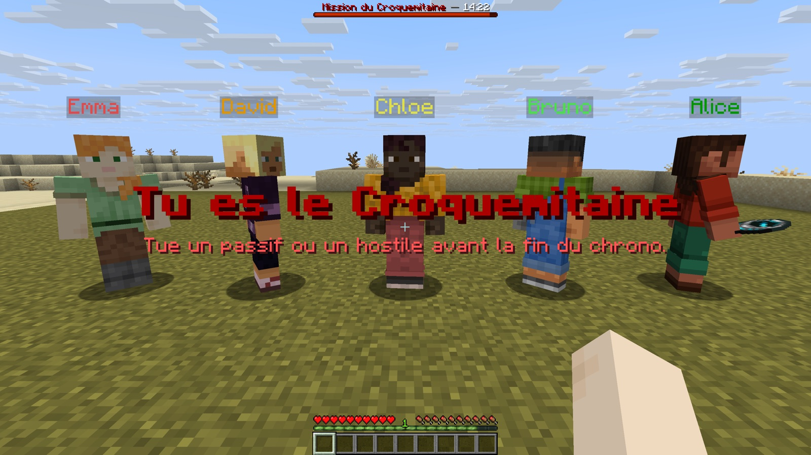

> 📄 Le guide du joueur existe aussi en PDF : [docs/Guide-Croquemitaine.pdf](docs/Guide-Croquemitaine.pdf). Toutes les captures de ce README sont de vraies captures du jeu, prises automatiquement (voir [Outils](#8-outils)).

## Sommaire

1. [Guide du joueur](#1-guide-du-joueur)
2. [Installer le plugin sur un serveur hébergé (Minestrator & co)](#2-installer-le-plugin-sur-un-serveur-hébergé-minestrator--co)
3. [Lancer et animer une partie](#3-lancer-et-animer-une-partie)
4. [Paramétrer le plugin (`config.yml`)](#4-paramétrer-le-plugin-configyml)
5. [Modifier les textes (`messages.yml`)](#5-modifier-les-textes-messagesyml)
6. [Chat vocal (Simple Voice Chat)](#6-chat-vocal-simple-voice-chat)
7. [Développement](#7-développement)
8. [Outils](#8-outils)

---

## 1. Guide du joueur

### La partie en bref

- **But :** être le **dernier joueur en vie**. Tout le monde démarre avec **5 vies**.
- **Toute mort coûte une vie**, quelle qu'en soit la cause (monstre, chute, lave, joueur…).
- Ton **nombre de vies fixe ton rôle** (passif, hostile, assassin) et donc qui tu as le droit de frapper. Ces règles se respectent **sur l'honneur** : le jeu ne bloque aucun coup.
- Le **PvP indirect est encouragé** : potions, pièges à TNT, trous, monstres sortis d'œufs…
- La partie se joue en **manches**. À partir de la manche 2, un joueur est désigné en secret **Croquemitaine**.
- La carte est **fermée par une bordure** (300 × 300 à 5 joueurs, jusqu'à 500 × 500 à 25). On apparaît et on réapparaît **à un endroit aléatoire**.
- On **garde son inventaire** à la mort : la vraie conséquence d'une mort, c'est de **se perdre**. La barre de localisation est désactivée.

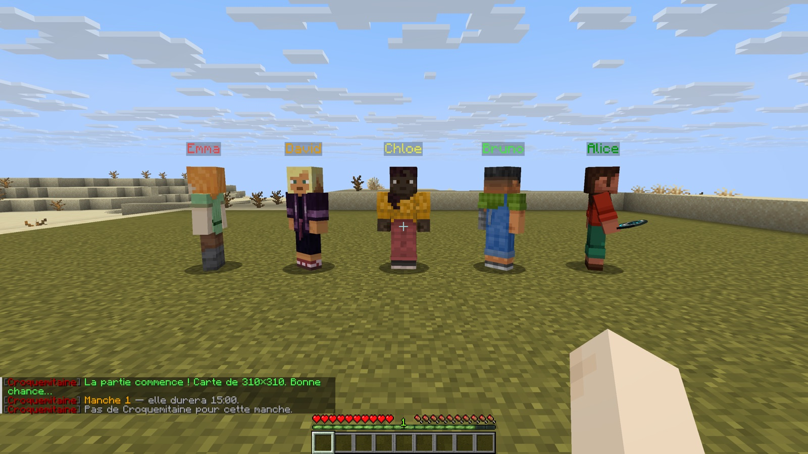

### Vies et couleurs

La couleur du pseudo indique les vies restantes, partout : au-dessus de la tête, dans la liste <kbd>Tab</kbd> (qui affiche aussi le nombre de vies) et dans le chat.

| Vies | Couleur | Rôle |
|---|---|---|
| 5 | 🟩 vert foncé | Passif |
| 4 | 🟢 vert clair | Passif |
| 3 | 🟨 jaune | Hostile |
| 2 | 🟧 orange | Hostile |
| 1 | 🟥 rouge | Assassin |
| 0 | ⬛ gris | Éliminé |

| Pseudos colorés | Liste <kbd>Tab</kbd> |
|---|---|
| 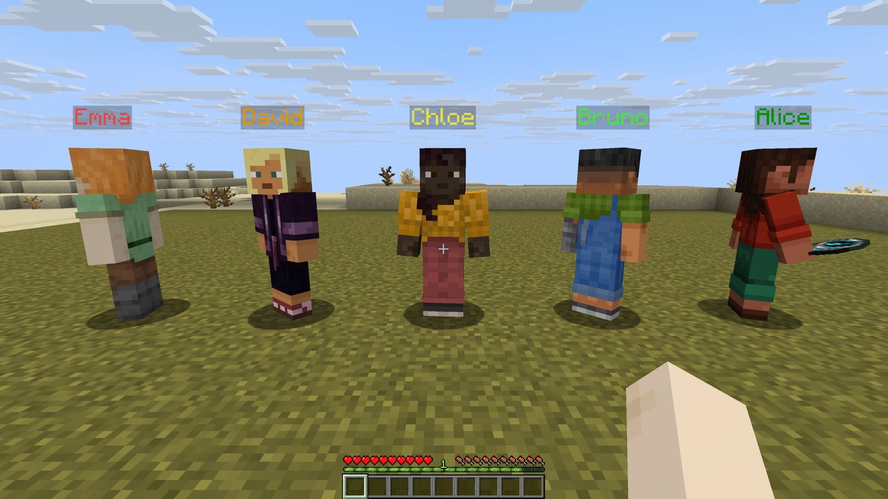 | 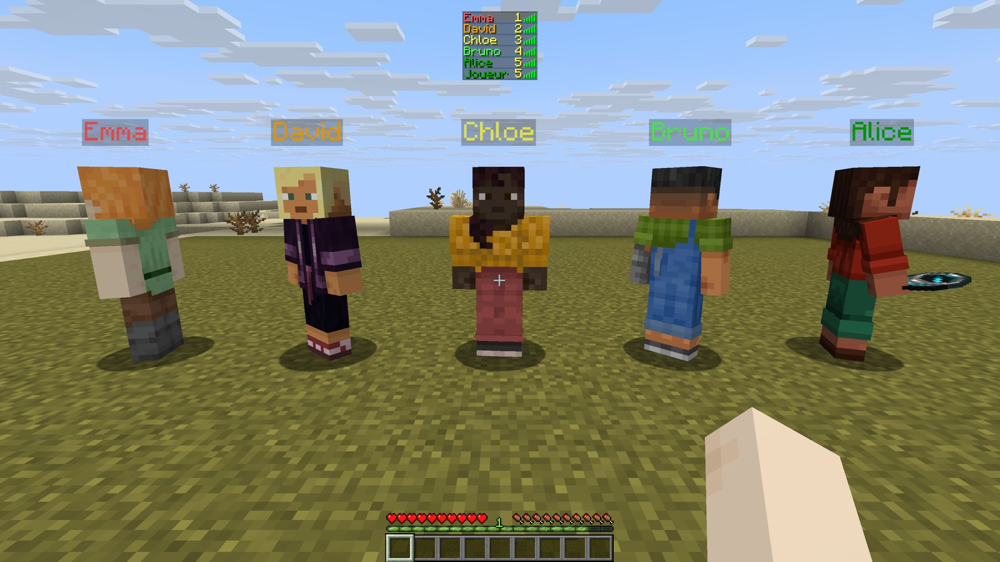 |

### Mourir et réapparaître

Tu gardes ton inventaire, mais tu réapparais **n'importe où sur la carte**. La commande `/death-history` liste toutes tes morts : date, coordonnées, cause et, si un joueur est responsable, son nom.

| Mort | Réapparition aléatoire | `/death-history` |
|---|---|---|
| 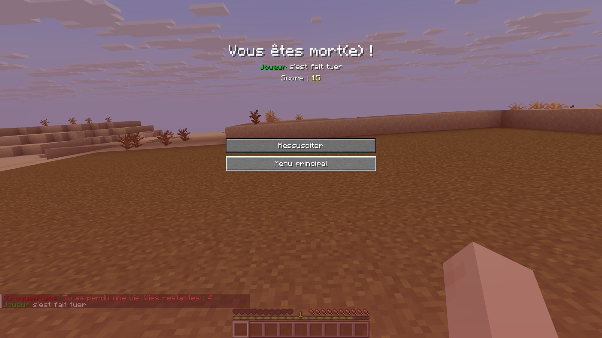 | 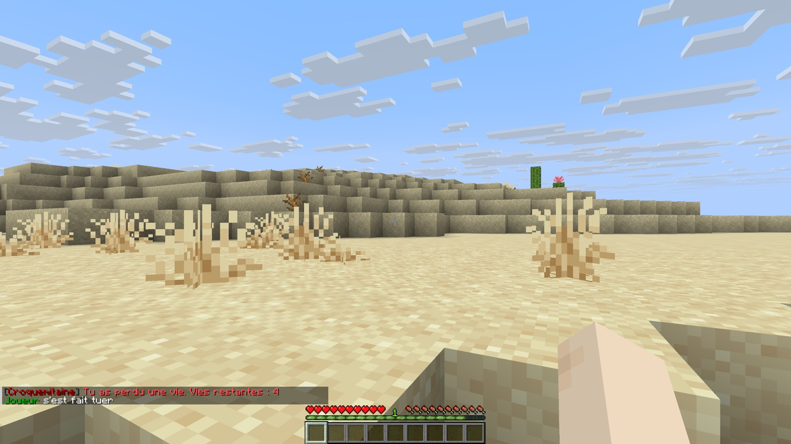 | 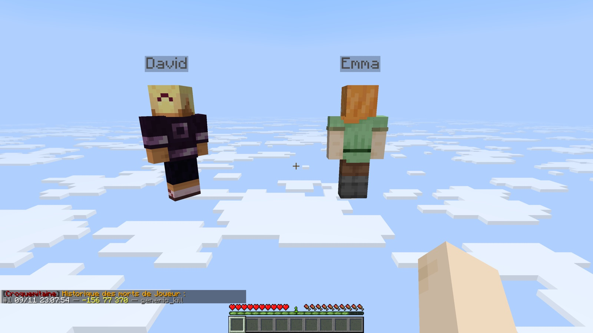 |

### Les rôles

- **Passif (5–4 vies)** : interdit de frapper les passifs et les hostiles. Tu peux te défendre contre un assassin ou le Croquemitaine s'il est à **40 blocs ou moins**.
- **Hostile (3–2 vies)** : tu as le droit d'attaquer les passifs, mais pas les hostiles. Mêmes droits de défense que le passif.
- **Assassin (1 vie)** : tu peux frapper tout le monde. Un assassin ne peut jamais devenir Croquemitaine.
- **Éliminé (0 vie)** : enfermé dans une **boîte aux murs invisibles, au-dessus de la carte**, jusqu'à la fin de la partie, même après une déconnexion. Ton chat n'est lu que par les autres éliminés, et tu es muet en vocal.

| Devenu hostile | Devenu assassin | Boîte d'élimination |
|---|---|---|
| 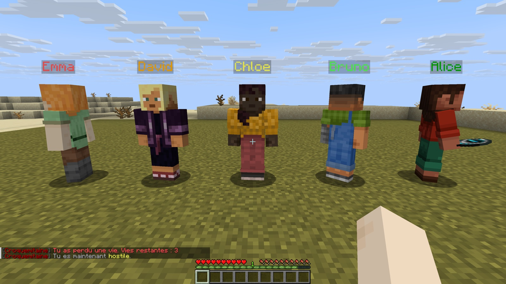 | 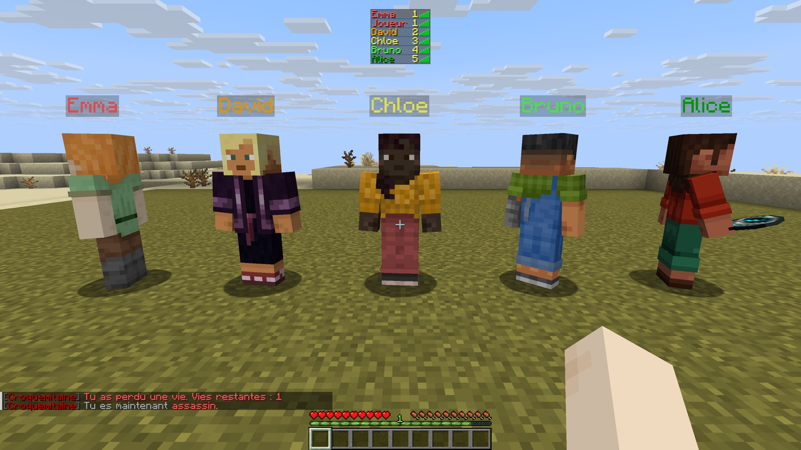 | 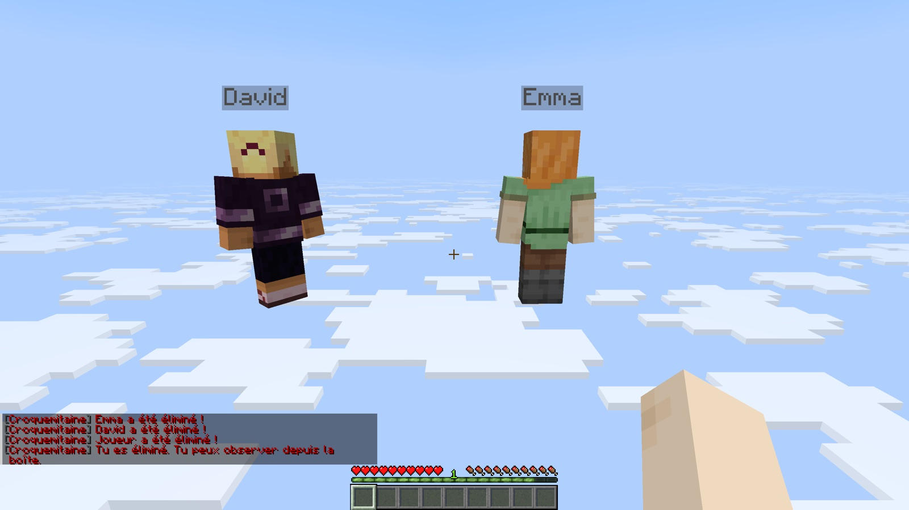 |

### Qui a le droit de frapper qui ? (règle d'honneur)

Ce tableau vaut pour les **coups directs**. Le jeu ne bloque rien : c'est à chacun de le respecter, et inutile de frapper tout le monde « pour voir » qui est le Croque.

| Attaquant ↓ / Cible → | Passif | Hostile | Assassin | Croquemitaine |
|---|---|---|---|---|
| **Passif** | ❌ | ❌ | ✅ si ≤ 40 blocs | ✅ si ≤ 40 blocs |
| **Hostile** | ✅ | ❌ | ✅ si ≤ 40 blocs | ✅ si ≤ 40 blocs |
| **Assassin** | ✅ | ✅ | ✅ | ✅ |
| **Croquemitaine** | ✅ | ✅ | ❌ | — |

- Le Croquemitaine garde sa couleur pour être attaqué : un hostile peut toujours frapper un Croque passif.
- Le **PvP indirect est libre** : potions, pièges à TNT, trous, lave, monstres sortis de tes œufs…
- Une mort par chute, lave ou vide juste après un coup est attribuée au dernier joueur qui t'a frappé dans les **10 secondes**.

> L'organisateur peut faire appliquer ce tableau par le plugin (`pvp.enforce: true`) : les coups interdits sont alors annulés.

### Le Croquemitaine : l'annonce

À partir de la **manche 2**, un joueur est tiré au sort parmi les **passifs et hostiles connectés**. Tout le monde voit la même animation, au même rythme : impossible de deviner qui a été choisi.

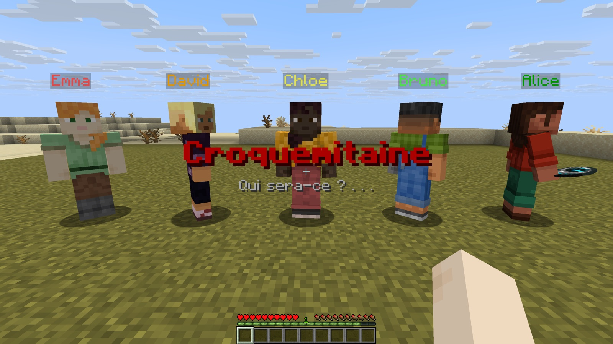

| Pour les autres | Pour l'élu |
|---|---|
| 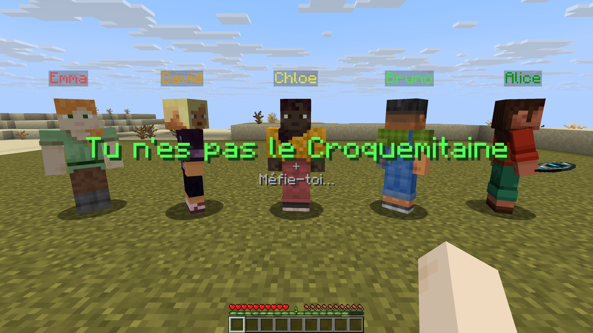 |  |

### Le Croquemitaine : pouvoirs

Juste après l'annonce s'ouvre une **roulette de 2 pouvoirs** : le Croque en choisit un (au hasard au bout de 15 s). En mode `random`, le pouvoir est tiré directement. Le **chrono secret** (barre rouge en haut de l'écran) n'est visible que par lui.

| Roulette | Chrono secret et items de pouvoir |
|---|---|
| 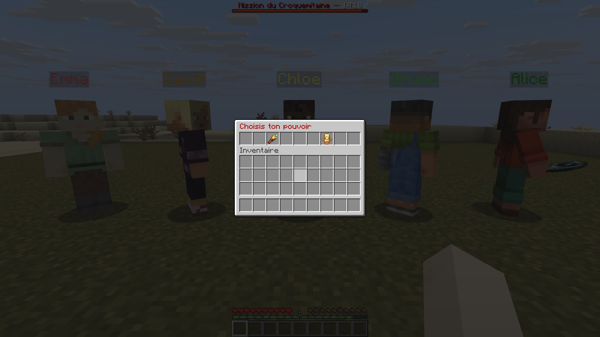 | 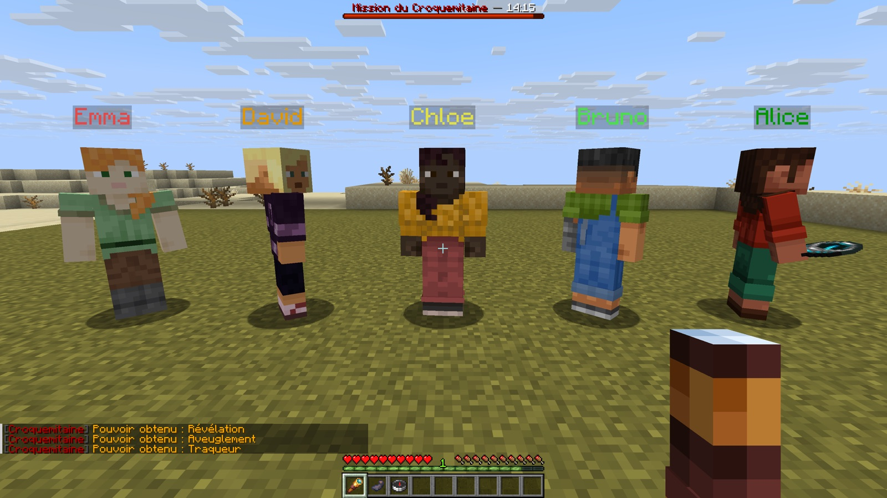 |

| Pouvoir | Effet | Type |
|---|---|---|
| Traqueur | Boussole vers la cible la plus proche (mise à jour toutes les 5 s) | Passif |
| Ombre | Invisibilité 20 s, armure et objet en main masqués. Recharge 2 min | Actif |
| Prédateur | Vitesse II | Passif |
| Brute | Force I | Passif |
| Carapace | Résistance I | Passif |
| Sursis | +3 min sur le chrono (seulement pour le Croque qui le tire, pas en héritage) | Immédiat |
| Second souffle | La 1ʳᵉ mort ne fait pas échouer la mission | Passif |
| Aveuglement | Cécité 4 s aux joueurs à 8 blocs ou moins. Recharge 90 s | Actif |
| Saut de l'ombre | Une fois : téléportation derrière la cible la plus proche (≤ 30 blocs) | Actif |
| Morsure | Ses coups infligent Lenteur II pendant 3 s | Passif |
| Révélation | Une fois : particules au-dessus de la cible la plus proche pendant 10 s, visibles par lui seul | Actif |

Les pouvoirs **actifs** s'utilisent par **clic droit** avec leur item. Ces items ne peuvent être ni jetés ni rangés, et disparaissent à la fin de la mission. *(Le pouvoir Déguisement existe mais est désactivé : avec l'héritage, le Croque suivant reconnaîtrait le précédent.)*

| Items de pouvoir | Révélation |
|---|---|
| 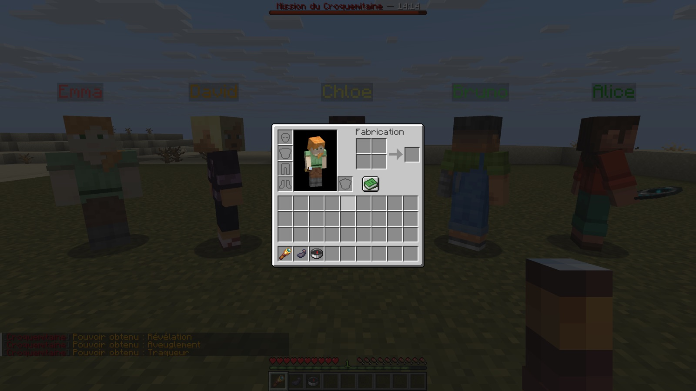 | 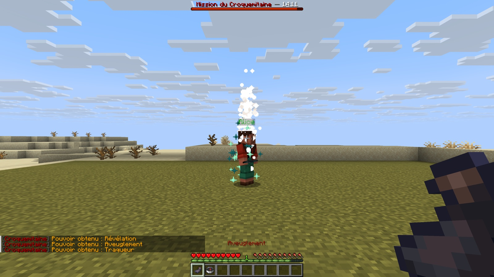 |

**Héritage :** chaque nouveau Croquemitaine reçoit **tous les pouvoirs des Croques précédents**, plus **un nouveau**. Il devient de plus en plus fort, mais avec de moins en moins de temps.

### Le Croquemitaine : la mission

Il doit tuer **de sa propre main** un **passif ou un hostile** avant la fin du chrono. Coups, flèches, TNT, monstres sortis de ses œufs : tout ce qu'il déclenche lui-même compte.

| Situation | Conséquence |
|---|---|
| **Kill réussi** | Il est libéré et perd ses pouvoirs, mais **la manche continue** jusqu'au bout du chrono, sans nouveau Croque. Personne ne sait que la mission a réussi. |
| **Chrono écoulé** | Il perd **1 vie**. Nouvelle manche, nouveau tirage. |
| **Il meurt pendant la mission** | Mission ratée, sans vie supplémentaire perdue. Nouvelle manche. |
| **Il se déconnecte** | Le chrono continue. S'il expire, il perd sa vie quand même. |

| Kill réussi | Chrono écoulé | Victime d'Aveuglement |
|---|---|---|
| 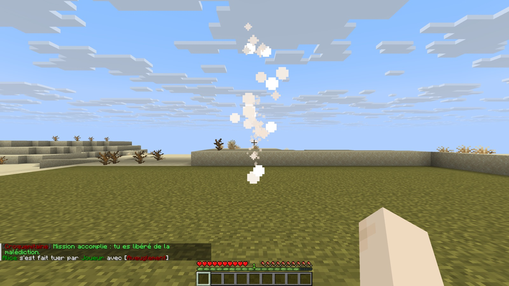 | 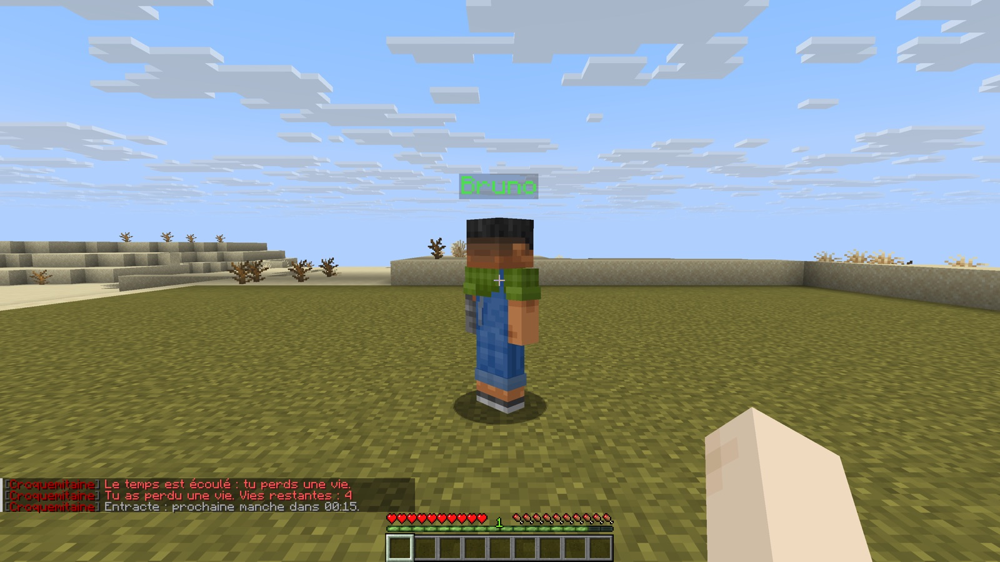 | 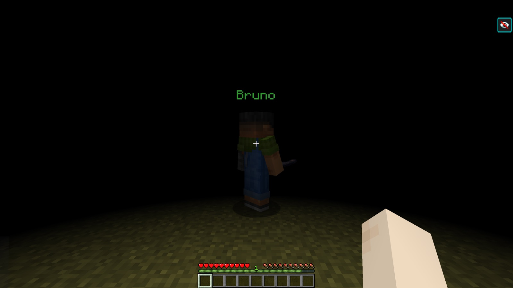 |

**Durée des manches** (par défaut) : 20 min à la manche 1, puis 2 min de moins à chaque manche, sans descendre sous 6 min.

### Règles spéciales

| Règle | Détail |
|---|---|
| Table d'enchantement | Impossible à fabriquer. Une **seule**, au centre de la carte, incassable et résistante aux explosions. |
| Casques | On **peut** porter un casque, une citrouille ou une tête, mais on est **empoisonné (Poison II)** tant qu'on le porte. |
| Phantoms | Désactivés. |
| Œufs de monstres | Tuer un monstre hostile a **25 %** de chances de faire tomber l'œuf d'un **autre** monstre (boss exclus). Ce monstre agit pour son propriétaire. |
| TNT simplifiée | **1 poudre à canon + 4 sable**, en plus de la recette normale. |

| Table d'enchantement | Casque = poison | Œuf de monstre |
|---|---|---|
| 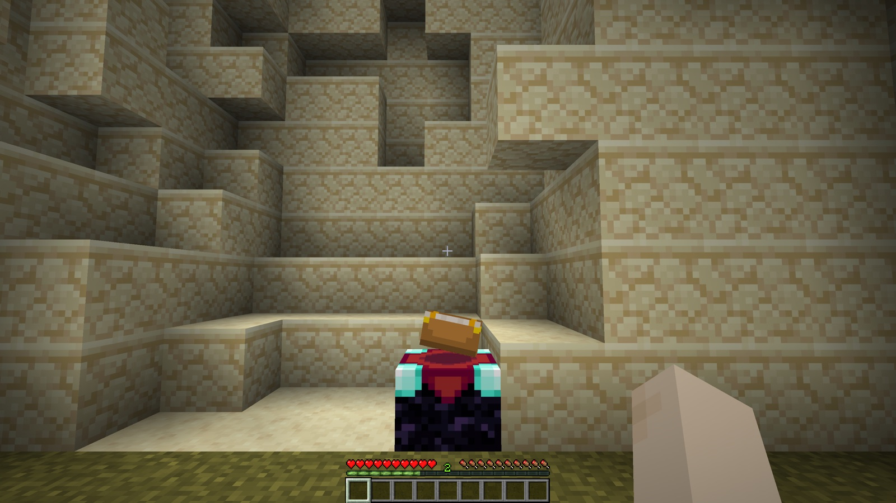 | 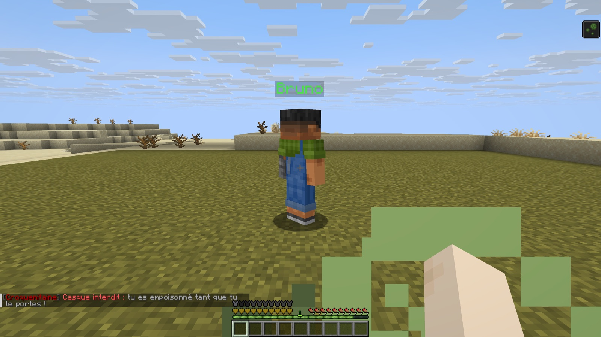 | 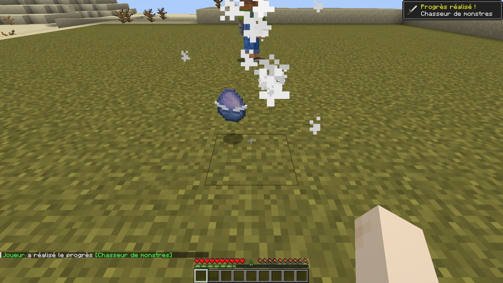 |

### Fin de partie

- **Il ne reste que des assassins** (au moins deux) : plus de Croquemitaine possible, et la **bordure se referme** progressivement.
- **Dernier survivant** : victoire, annonce à tous et feu d'artifice.

| La bordure se referme | Victoire |
|---|---|
| 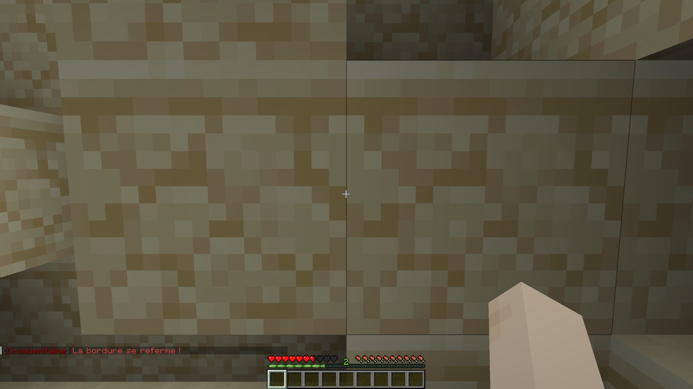 | 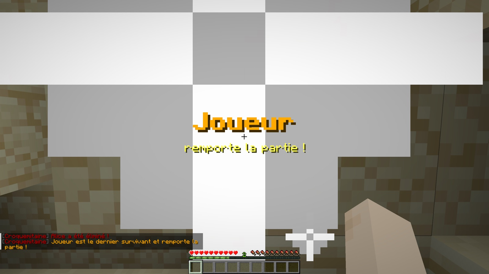 |

---

## 2. Installer le plugin sur un serveur hébergé (Minestrator & co)

### Ce qu'il faut

| Élément | Version |
|---|---|
| Serveur | **Paper 26.3** (Spigot et Bukkit ne suffisent pas : le plugin utilise l'API Paper) |
| Java | **25** (minimum de Minecraft 26.x ; les hébergeurs le choisissent en général tout seuls selon la version) |
| Plugin | `croquemitaine-<version>.jar` (onglet *Releases* du dépôt, ou à compiler : voir [Développement](#7-développement)) |
| Optionnel | **Simple Voice Chat** `bukkit-2.6.27` pour le vocal de proximité ([Modrinth](https://modrinth.com/plugin/simple-voice-chat)) |
| Joueurs | Minecraft **26.3**. Avec le vocal : Fabric + mod Simple Voice Chat `fabric-2.6.27+26.3` (un modpack prêt à l'emploi est dans [`tools/modpack`](tools/modpack)) |

### Pas à pas (Minestrator ou tout panel du même type)

1. **Logiciel et version :** dans le panel de l'hébergeur, choisis le logiciel **Paper** en version **26.3**, puis démarre le serveur une première fois pour qu'il génère ses fichiers. Arrête-le ensuite.
2. **Envoyer le plugin :** avec le gestionnaire de fichiers du panel (sur Minestrator, le **WebFTP**) ou en SFTP, dépose `croquemitaine-<version>.jar` dans le dossier **`/plugins`**. Pour le vocal, ajoute aussi le jar de Simple Voice Chat.
3. **Démarrer** le serveur : le plugin crée `plugins/Croquemitaine/config.yml` et `messages.yml`. Dans la console, tu dois voir `Croquemitaine activé.`, plus `Intégration Simple Voice Chat active.` si le vocal est installé.
4. **Te donner les droits :** dans la console du panel, tape `op <ton pseudo>`. Toutes les commandes `/croque` demandent la permission `croque.admin`, donnée par défaut aux opérateurs.
5. **Régler la partie :** édite `plugins/Croquemitaine/config.yml` avec le gestionnaire de fichiers (voir [section 4](#4-paramétrer-le-plugin-configyml)), puis tape `/croque reload` en jeu (pas besoin de redémarrer).
6. **Vocal (optionnel) :** voir [section 6](#6-chat-vocal-simple-voice-chat). Sur Minestrator, il faut un des **ports dédiés** de l'onglet **« Accès »** du panel.
7. **Vérifier :** `/plugins` doit lister `Croquemitaine` en vert, et `/croque status` doit répondre.

> ⚠️ **Ne jamais réutiliser** le dossier `run/` ni le `server.properties` de test de ce dépôt sur un vrai serveur. Il est en `online-mode=false`, avec RCON et ViaVersion, et n'est prévu que pour tester en local.

### Avant la partie

- **La carte :** la partie se joue dans le monde `world`, centrée sur `map.center` (0, 0 par défaut). Choisis un centre **sur la terre ferme** : si la zone est surtout de l'eau, les réapparitions retombent au centre et la console affiche un avertissement.
- **La boîte d'élimination** est construite automatiquement au-dessus du centre (y = 300), et la **table d'enchantement** est posée au centre au lancement.
- **Les règles du monde** (`keepInventory`, barre de localisation, phantoms, rayon d'apparition…) sont appliquées automatiquement par `/croque start` : rien à régler à la main.
- **Sauvegardes :** l'état de la partie est enregistré dans `plugins/Croquemitaine/game.json` (toutes les 30 s et à chaque événement). Une partie survit à un redémarrage du serveur, chrono compris.

### En local, pour tester

```bash
./gradlew runServer          # télécharge Paper 26.3 et lance un serveur dans run/ avec le plugin
```

Pour te connecter, le plus simple est d'importer le modpack [`tools/modpack/Croquemitaine-test.mrpack`](tools/modpack) dans Modrinth App. Le serveur `localhost` y est déjà ajouté.

---

## 3. Lancer et animer une partie

1. Tous les joueurs se connectent.
2. `/croque start` : calcule la taille de la carte, applique les règles, pose la table, fait apparaître tout le monde au hasard et lance la manche 1, qui se joue sans Croquemitaine.
3. Le reste est automatique : manches, tirages, pouvoirs, éliminations, fin de partie.

| Commande | Effet |
|---|---|
| `/croque start` | Lance la partie |
| `/croque pause` · `/croque resume` | Gèle / reprend le chrono |
| `/croque stop` | Termine la partie et nettoie tout (pouvoirs, équipes, table) |
| `/croque status` | Croque actuel, ses pouvoirs, chrono, vies de chacun (**admins seulement**) |
| `/croque force <joueur>` | Désigne le Croquemitaine de la manche |
| `/croque givepower <pouvoir>` | Donne un pouvoir au Croque actuel |
| `/croque skip` | Termine la manche sans pénalité |
| `/croque lives <joueur> set\|add\|remove <n>` | Modifie les vies |
| `/croque revive <joueur>` | Sort un éliminé avec 1 vie |
| `/croque border <taille> [secondes]` | Ajuste la bordure |
| `/croque reload` | Recharge `config.yml` et `messages.yml` |
| `/death-history [joueur]` | Historique des morts (celui des autres : admins seulement) |

Identifiants des pouvoirs pour `givepower` : `tracker`, `shadow`, `predator`, `brute`, `shell`, `reprieve`, `disguise`, `second_wind`, `blind`, `shadow_step`, `bite`, `reveal`.

---

## 4. Paramétrer le plugin (`config.yml`)

Le fichier est `plugins/Croquemitaine/config.yml`. Tout ce qui est réglable s'y trouve : rien n'est codé en dur. Après une modification, tape `/croque reload`.

> ℹ️ Une durée de manche modifiée s'applique **à partir de la manche suivante**, car la durée de la manche en cours est déjà fixée. `/croque skip` passe à la suivante tout de suite.

### Vies et carte

```yaml
lives:
  start: 5                 # vies au départ

map:
  size-min: 300            # côté de la carte avec players-min joueurs
  size-max: 500            # côté de la carte avec players-max joueurs (interpolation entre les deux)
  players-min: 5
  players-max: 25
  center: { x: 0, z: 0 }   # centre de la carte : choisir un endroit sur la terre ferme
  world: world             # monde de jeu
  spawn-attempts: 100      # essais pour trouver une position d'apparition sûre
```

### Combat

```yaml
pvp:
  enforce: false           # false : la matrice est une règle d'honneur, rien n'est bloqué (PvP indirect libre)
                           # true  : le plugin annule les coups interdits (mêlée, flèches, potions…)
  defense-radius: 40       # distance de défense contre un assassin ou le Croque (si enforce: true)
  kill-credit-seconds: 10  # une mort (chute, lave…) est attribuée au dernier joueur qui a frappé dans ce délai
```

### Manches

```yaml
rounds:
  initial-minutes: 20      # durée de la manche 1
  decrement-minutes: 2     # minutes retirées à chaque manche
  min-minutes: 6           # durée plancher
  initial-seconds-override: 0    # si > 0, remplace les valeurs en minutes (pratique pour tester)
  decrement-seconds-override: 0
  min-seconds-override: 0
  intermission-seconds: 0  # pause entre deux manches
  announce-suspense-seconds: 5   # durée de l'animation « Qui sera-ce ? »
  power-choice-seconds: 15       # temps pour choisir son pouvoir dans la roulette
  roulette-delay-seconds: 3      # délai avant l'ouverture de la roulette (laisse lire le titre)
```

Durée de la manche N : `max(min, initial − décrément × (N − 1))`. Avec les valeurs par défaut : 20, 18, 16, 14, 12, 10, 8, 6, 6, 6… minutes.

### Pouvoirs

```yaml
powers:
  mode: choice             # choice : roulette de 2 pouvoirs au choix | random : pouvoir tiré au hasard
  inherit: true            # chaque Croque hérite des pouvoirs des Croques précédents (+1 nouveau)
  # Poids de tirage : plus il est grand, plus le pouvoir sort souvent. 0 = jamais.
  tracker: 10
  shadow: 10
  predator: 10
  brute: 10
  shell: 10
  reprieve: 10
  disguise: 0              # désactivé par défaut
  second_wind: 5
  blind: 10
  shadow_step: 5
  bite: 10
  reveal: 10
  settings:
    reprieve-minutes: 3
    shadow-duration-seconds: 20
    shadow-cooldown-seconds: 120
    blind-radius: 8
    blind-duration-seconds: 4
    blind-cooldown-seconds: 90
    shadow-step-range: 30
    tracker-update-seconds: 5
    bite-slowness-seconds: 3
    reveal-duration-seconds: 10
```

### Éliminés et fin de partie

```yaml
elimination:
  mode: box                # box : boîte au-dessus de la carte | spectator : spectateur (téléportation entre joueurs)
  private-chat: true       # le chat des éliminés n'est lu que par les éliminés

elimination-box:
  y: 300                   # hauteur de la boîte (ajustée automatiquement sous la limite du monde)
  inner-size: 9
  inner-height: 4

endgame:                   # quand il ne reste que des assassins
  shrink-delay-seconds: 60     # délai avant que la bordure se referme
  shrink-target-size: 30       # taille finale
  shrink-duration-seconds: 600 # durée du rétrécissement
```

### Règles spéciales

```yaml
rules:
  mob-egg-chance: 0.25     # chance (0 à 1) qu'un monstre hostile tué lâche un œuf
  mob-egg-excluded: [ENDER_DRAGON, WITHER, WARDEN, ELDER_GUARDIAN]
  tnt-simplified: true     # recette 1 poudre + 4 sable
  helmet-ban: true         # règle des casques active
  helmet-mode: poison      # poison : casque portable mais Poison II tant qu'il est porté | block : impossible à équiper
  phantoms: false          # false : aucun phantom
  enchanting-table-at-center: true
  immediate-respawn: false # réapparition sans écran de mort
  recovery-compass: false  # boussole vers le dernier lieu de mort

voice:
  mute-eliminated: true    # éliminés muets en vocal (si Simple Voice Chat est installé)

storage:
  autosave-seconds: 30
```

---

## 5. Modifier les textes (`messages.yml`)

Tous les textes affichés aux joueurs sont dans `plugins/Croquemitaine/messages.yml`, au format [MiniMessage](https://docs.advntr.dev/minimessage/format.html) (`<red>`, `<b>`, `<gold>`…). On peut tout traduire ou reformuler, puis faire `/croque reload`. Une clé supprimée retombe sur le texte d'origine.

---

## 6. Chat vocal (Simple Voice Chat)

Facultatif : sans lui, le plugin fonctionne normalement.

1. Mets le plugin **Simple Voice Chat** `bukkit-2.6.27` dans `/plugins` et démarre le serveur une fois.
2. Ouvre `plugins/voicechat/voicechat-server.properties` et règle :
   ```properties
   port=<port UDP dédié>   # sur Minestrator : un des ports dédiés de l'onglet « Accès » du panel
   max_voice_distance=18   # vocal de proximité, portée courte
   enable_groups=false     # pas de groupes : sinon on pourrait se parler à distance
   ```
3. Redémarre le serveur. Les joueurs installent le mod client **Simple Voice Chat** (Fabric), par exemple avec le modpack de [`tools/modpack`](tools/modpack).

Le vocal passe par un **port UDP séparé** du port du jeu : c'est la cause de panne la plus fréquente. Sur Minestrator, la marche à suivre officielle est ici : [ajouter le voice chat à son serveur](https://minestrator.com/blog/post/add-voicechat-minecraft-server). Avec `voice.mute-eliminated: true`, les éliminés ne sont plus entendus.

---

## 7. Développement

| Élément | Version |
|---|---|
| Java | 25 |
| API | `io.papermc.paper:paper-api:26.3.build.246-stable` |
| Build | Gradle 9.9 (wrapper) |

```bash
./gradlew build        # compile + tests unitaires → build/libs/croquemitaine-<version>.jar
./gradlew runServer    # serveur Paper 26.3 de test dans run/ (ViaVersion/ViaBackwards inclus pour les bots)
```

- **Architecture :** le cœur du jeu (`core/`) est en Java pur, sans Bukkit, et testé en JUnit. Les services Bukkit (`game/`, `players/`, `combat/`, `powers/`, `rules/`) traduisent les événements. Détails dans [`CLAUDE.md`](CLAUDE.md), qui sert aussi de spec de référence.
- **Tests en conditions réelles :** [`tests/bots`](tests/bots) contient plus de 130 scénarios joués par des bots Mineflayer et via RCON sur un vrai serveur local : `cd tests/bots && npm install && node scenarios.mjs`.
- **Idées en attente :** [`docs/Backlog.md`](docs/Backlog.md).

---

## 8. Outils

| Dossier | À quoi il sert |
|---|---|
| [`tools/modpack`](tools/modpack) | Profil **Modrinth** prêt à importer : Minecraft 26.3, Fabric, Simple Voice Chat, avec le serveur local déjà ajouté. |
| [`tools/camera-mod`](tools/camera-mod) | **Mod client de captures automatiques** : un vrai client Minecraft qui prend des captures sur ordre du serveur, sans personne devant l'écran. Voir son [README](tools/camera-mod/README.md). |
| [`tools/guide`](tools/guide) | Le **réalisateur** qui met en scène chaque phase, les captures, et la génération du [guide PDF](docs/Guide-Croquemitaine.pdf). |
